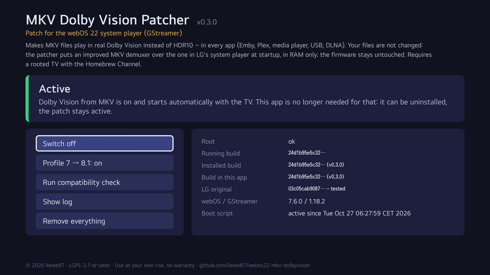
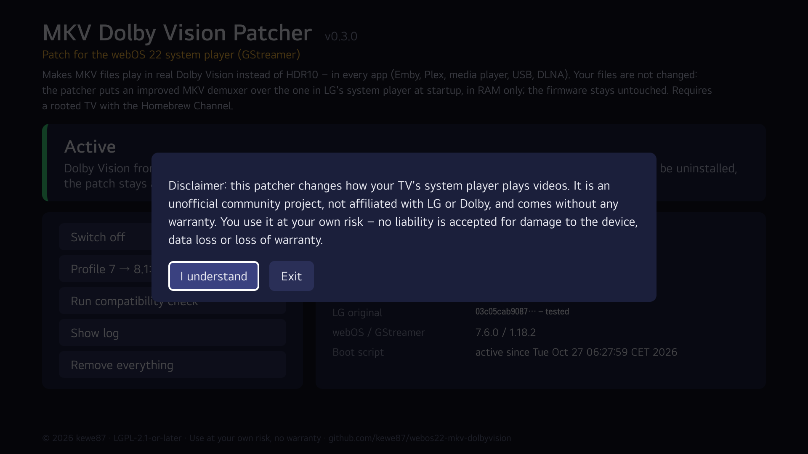
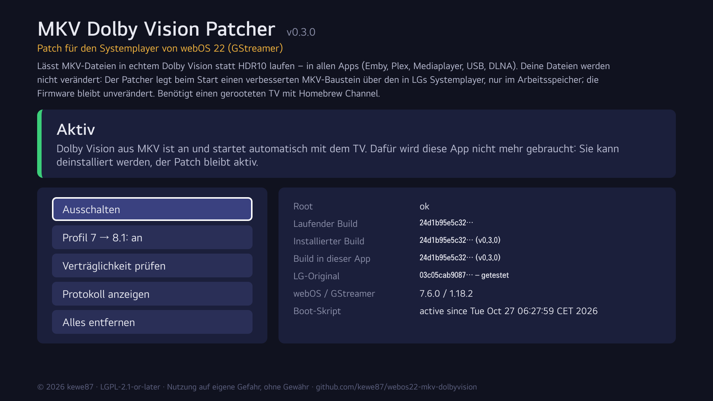

# webos-mkv-dolbyvision

System-wide **Dolby Vision playback from MKV files** on rooted LG TVs:
Emby, Plex, the LG media player, USB, DLNA – every app that uses LG's media pipeline.
Optionally converts **Dolby Vision profile 7** (UHD Blu-ray remuxes) to **profile 8.1** on the fly.

Fully tested on **webOS 22**; **experimental builds for webOS 6 (2021, LG C1) and webOS 5 (2020)** are
also bundled. The app picks the right one for your TV automatically, by GStreamer version
(see *Supported TVs* below).

**What gets patched:** not your MKV files – they stay untouched. The patch replaces the MKV demuxer of
the TV's system player (GStreamer plugin `libgstmatroska.so`) with an improved version, **in RAM only**.
It comes with **MKV Dolby Vision Patcher**, a Homebrew Channel app to switch it on and off.



> **Requirements: a rooted TV.** Root access (e.g. via [RootMyTV](https://rootmy.tv) / the
> [webOS Homebrew Channel](https://github.com/webosbrew/webos-homebrew-channel)) and SSH are mandatory:
> the patched demuxer is put over a system file with a bind mount and started by a Homebrew Channel
> boot script. It does **not** work on non-rooted TVs.

> **Status: beta.** Fully tested on one TV: LG 86QNED916QE (board K8HP), webOS 22, firmware 04.60.91.
> Profile 8.1 works (Dolby Vision logo in Emby). Profile 7 → 8.1 has been verified with dovi_tool test
> data and a synthetic clip, but **not yet with a real UHD Blu-ray remux**.
>
> Additional builds for **webOS 6 (LG C1, GStreamer 1.16.2)** and **webOS 5 (2020 line-up, GStreamer
> 1.14.4)** are included but are **experimental**: they were cross-compiled against LG's own source for
> that version and statically verified, but have **not been confirmed on real hardware**. The app marks
> them as experimental; if anything is wrong it falls back to HDR10.

> **Disclaimer: use at your own risk.** This is an unofficial community project, not affiliated with
> or endorsed by LG or Dolby. It changes how your TV's system player works and requires root access.
> It is provided "as is", without warranty of any kind. The author accepts no liability for damage to
> your TV, data loss, loss of warranty or any other consequence of using it. See also sections 15 and 16
> of the `LICENSE`.

## Supported TVs

The app bundles one demuxer build per **GStreamer version** – the ABI the plugin binds to, identical
across TV models of the same webOS major – and picks the right one automatically:

| webOS | Year / examples | GStreamer | Status |
|---|---|---|---|
| **webOS 22** | 2022 (e.g. C2 / G2 / QNED) | 1.18.2 | **verified** |
| webOS 6 | 2021 (e.g. LG C1) | 1.16.2 | experimental |
| webOS 5 | 2020 (OLED CX / GX / BX, premium NanoCell) | 1.14.4 | experimental |

Support is tracked per GStreamer version, so once a version is confirmed on one real TV it applies to
every TV on that version. The **experimental** builds were cross-compiled against LG's own source for
that version and statically verified, but are **not yet confirmed on real hardware** – the app flags them
and falls back to HDR10 if anything is off, and the RAM-only overlay is cleared by a reboot. A TV whose
GStreamer version has no bundled build needs one compiled from LG's matching source package (the app's
**Diagnostics** button prepares the request).

## Why

LG's webOS 22 plays Dolby Vision from MP4 and TS, but its matroska demuxer (`libgstmatroska.so`,
GStreamer 1.18.2) ignores the Dolby Vision configuration stored in MKV files
(`BlockAdditionMapping` with `dvcC`/`dvvC`). Every app therefore falls back to HDR10.
LG fixed this only in webOS 25.

## How it works

- `src/matroska/` is **LG's own webOS 22 source** of the GStreamer matroska plugin (from LG's
  open-source package "webOS 22 KHP 12.0", opensource.lge.com), patched with:
  - **Dolby Vision detection** ported from LG's webOS 25 code
    ([lgstreamer/gstreamer-webos-25](https://github.com/lgstreamer/gstreamer-webos-25)). It sets the
    same caps fields LG's webOS 22 MP4 demuxer uses (`dolby-vision`, `dolby-vision-profile`) and queries
    the platform's `dolby-vision-support` smart property like LG's qtdemux.
  - **Hardening compared to LG's webOS 25 code:**
    - it never posts an error – anything unexpected leaves the caps untouched (plain HDR10 as before);
    - only video tracks are flagged;
    - mapping values are only committed when the entry really is Dolby Vision, so HDR10+ block
      additions cannot overwrite them;
    - length check and missing `g_free` fixed.
  - **Profile 7 → 8.1** for HEVC tracks with BL compatibility 6, implemented as a per-frame
    postprocess step:
    - the enhancement layer is dropped (NAL type 63 and `nuh_layer_id > 0`);
    - every RPU (NAL type 62) is rewritten with [libdovi](https://github.com/quietvoid/dovi_tool),
      identical to `dovi_tool -m 2`;
    - an RPU that cannot be converted is dropped, never forwarded as profile 7.

    As with every player that does this (Zidoo, Shield/Plex, PlxNative), the residual of a **FEL**
    is lost; a **MEL** loses nothing.
- **Diagnostics:** a short log is written to `/tmp/matroska-dv.log` (configuration, decision, caps,
  conversion counters).
- `patches/` contains the full diff against LG's unmodified source.
- Built with LG's own toolchain (starfish SDK 7.0.0, GCC 9.3, Cortex-A9, softfp) against LG's sysroot.
  A rebuild of the unmodified LG source has the same dependencies and symbols as the file on the TV.

## Safety and persistence

- **RAM only, not permanent by default:** the patch is a **bind mount in RAM** over LG's plugin. LG's
  files on disk are never touched. **By default it is active only until the next reboot** – a restart
  brings LG's original back. Nothing is written to firmware partitions.
- **Autostart is your choice:** tick **"Load automatically at boot"** in the app (or
  `ctl.sh enable --persist` / `ctl.sh persist on`) to re-apply the patch at every cold boot. This needs
  the Homebrew Channel's boot hook (`/var/lib/webosbrew/init.d`), which **depends on the TV's firmware
  and Homebrew Channel version** – newer firmware has removed/patched this hook, and where it is missing
  the app says so and the patch stays RAM-only. Recommended flow: switch on *without* autostart, test
  your Dolby Vision MKVs, and only then enable autostart. (A RAM mount survives standby/wake; only a full
  cold boot clears it, which is exactly when autostart re-applies it.)
- **Right build per version:** the plugin is chosen by the TV's **GStreamer version** – the ABI it binds
  to, identical across TV models of the same webOS major – listed in `tv/variants.tab`. A version
  confirmed on real hardware is `verified`; an unverified build (e.g. webOS 6/C1) is flagged experimental
  in the app. Before overlaying, an unverified build or a never-seen original is first loaded in an
  **isolated GStreamer instance** and only activated if that passes.
- **Runtime guard:** the boot script re-activates only when the current LG original is exactly the one
  the patch was enabled against (checksum match) and the replacement matches its own checksum. A firmware
  update that changes the original simply leaves LG's file in place until you switch on again.
- **Fallback behaviour:** unknown or unusual files keep LG's behaviour (plain HDR10).
- **Off switches:**
  - the app's "Switch off" button, or `ctl.sh disable` – everything off (right away if no video is
    playing, otherwise after a reboot);
  - "Load automatically at boot" unticked, or `ctl.sh persist off` – stays active now, but will not come
    back after a restart;
  - `touch /media/developer/mkvdv/disable` and reboot – everything off;
  - `touch /media/developer/mkvdv/disable-p7` – only the profile 7 conversion off (from the next
    playback on).

## Install with the app (recommended)

The release contains the Homebrew Channel app **GStreamer DV MKV Patcher**
(`io.github.kewe87.mkvdv_<version>_all.ipk`). It shows the status and has buttons to switch on/off, a
**"Load automatically at boot"** checkbox for autostart, and controls to toggle profile 7 → 8.1, run the
compatibility check, show the logs and remove everything. English or German, following the TV's language.

1. Install the `.ipk`, e.g. with `ares-install` or by adding the release's
   `io.github.kewe87.mkvdv.manifest.json` URL as a repository in the Homebrew Channel.
2. Open **GStreamer DV MKV Patcher**, accept the disclaimer and press **Switch on**. Leave autostart off
   for the first test; tick **"Load automatically at boot"** once it plays as expected.

| | |
|---|---|
|  |  |

**Root check:** the app runs `ctl.sh` as root through the Homebrew Channel's `exec` service. On every
start it first checks that this really works (`id -u` = 0). Without root it shows "Root service not
reachable" and every button except "Check again" is locked; `ctl.sh` itself refuses to run without root
as well. Make sure the Homebrew Channel shows "Root status: ok".

**Can I uninstall the app afterwards?** Yes. Switching on copies the demuxer and the boot script to
`/media/developer/mkvdv/`; the boot script does not depend on the app. The patch stays active, also
after reboots, when the app is removed. To remove the patch completely, press **Remove everything**
(or **Switch off**) *before* uninstalling the app – or later over SSH with
`sh /media/developer/mkvdv/ctl.sh uninstall`.

## Did it work for you? ⭐

If the patch gave you Dolby Vision from MKV, I'd be glad if you left the repo a **star** – it helps
other LG owners find the project, and it means a lot. Thank you! If something didn't work, please open an
[issue](https://github.com/kewe87/webos-mkv-dolbyvision/issues) with the **Diagnostics** report instead.

## Command line

The same functions over SSH (`/media/developer/mkvdv/ctl.sh` after the first install):

```sh
ctl.sh status                   # JSON status
ctl.sh probe                    # read-only diagnostics for a port request (writes /tmp/mkvdv-probe.txt)
ctl.sh enable [--persist] [--force]  # install/update and activate in RAM; --persist also adds autostart
ctl.sh persist on|off           # add / remove autostart later (needs the webOSbrew boot hook)
ctl.sh disable                  # deactivate (and remove autostart)
ctl.sh p7 on|off                # profile 7 -> 8.1 conversion
ctl.sh check                    # load the matching build in an isolated GStreamer instance
ctl.sh log               # boot script and demuxer logs
ctl.sh uninstall         # deactivate and delete all files
```

## Manual install over SSH

1. Download `libgstmatroska.so` and `tv-scripts.tar.gz` from the
   [releases](../../releases) and copy them to the TV, e.g. into `/tmp/mkvdv-install/`.
   Use `scp -O` – piping binaries through some shells corrupts them.
2. Check your LG original:

   ```sh
   md5sum /usr/lib/gstreamer-1.0/libgstmatroska.so
   ```

   If the checksum is not listed in `supported-originals.md5`, run the isolated test below first.
   Only if it works, install with `--force`.
3. Install:

   ```sh
   cd /tmp/mkvdv-install && tar xzf tv-scripts.tar.gz && sh tv/install.sh
   ```

**Uninstall:** `sh /media/developer/mkvdv/ctl.sh uninstall` (a reboot is only needed if a video was
playing).

## Isolated test (no system change)

Runs a private GStreamer instance with its own registry in `/tmp`:

```sh
mkdir -p /tmp/mkvtest/dv && cp libgstmatroska.so /tmp/mkvtest/dv/
ln -sf /usr/lib/gstreamer-1.0/libgstcoreelements.so /tmp/mkvtest/dv/
env -i PATH=/usr/bin:/bin HOME=/tmp/mkvtest GST_REGISTRY_1_0=/tmp/mkvtest/reg.bin \
  GST_PLUGIN_SYSTEM_PATH_1_0=/tmp/mkvtest/dv GST_PLUGIN_PATH_1_0= \
  gst-launch-1.0 -v filesrc location=/path/to/dolby-vision.mkv ! matroskademux name=d d.video_0 ! fakesink
cat /tmp/matroska-dv.log
```

The video caps must contain `dolby-vision=(boolean)true, dolby-vision-profile=(int)8`
(for profile 5 files: `5`).

## Build (Linux / WSL)

1. Install LG's starfish SDK, `starfish-sdk-x86_64-ca9v1-toolchain-7.0.0.sh`, from part 1 of LG's
   "webOS 22 KHP" source package, e.g. into `~/tc/starfish`.
2. Extract `target_sysroot_dependencies.tar.gz` (inside `gstreamer_*.zip` of the same package) into
   `$SDKTARGETSYSROOT`.
3. Install Rust via rustup and add the TV target: `rustup target add armv7-unknown-linux-gnueabi`.
4. Build:

   ```sh
   build/build-libdovi.sh      # libdovi as a static library (pinned commit)
   build/build.sh              # -> out/libgstmatroska.so  (primary: webOS 22)
   build/package.py            # -> out/release/ (.so, tv-scripts, .ipk, manifest, SHA256SUMS)
   ```

   The package bundles one plugin per webOS variant and picks the right one on the TV by GStreamer
   version. Additional variants are built the same way against that version's LG source package and
   placed at `out/plugins/<variant>/libgstmatroska.so` before `build/package.py`. The experimental
   **webOS 6 / LG C1** build (GStreamer 1.16.2, LG package "webOS 6.0 ON 1.0") and the experimental
   **webOS 5** build (GStreamer 1.14.4, LG package "webOS 5.0 JO 1.0") use LG's own source for that
   version with the same `patches/` diff. `tv/variants.tab` records each variant's GStreamer version and
   whether it is verified on real hardware.

`tests/dovi_test.c` checks the libdovi conversion on the TV against dovi_tool's test data.
`tests/fakep7.py` turns a profile 8 clip into a synthetic profile 7 clip for pipeline tests.

## Limitations

- **Verified on webOS 22** (GStreamer 1.18.2); **experimental webOS 6 / LG C1** (GStreamer 1.16.2) and
  **webOS 5** (GStreamer 1.14.4) builds are bundled but not yet confirmed on real hardware. Support is
  tracked per **GStreamer version**,
  so once a version is confirmed on one TV it applies to every TV on that version; a version with no
  bundled build needs one from LG's matching source package. The app's **Diagnostics** button (or
  `ctl.sh probe`) collects, read-only, the facts a port
  needs – model and firmware, webOS/GStreamer/GLib versions, board/CPU, the original demuxer's checksum,
  the video decoder elements and whether the platform exposes a Dolby Vision pipeline at all – and
  offers them as a pre-filled GitHub issue (shown as a QR code), with the TV's serial number and MAC
  addresses redacted. The full report is written to `/tmp/mkvdv-probe.txt`; **if a USB stick is plugged
  in, the same report is also saved onto it** as `mkvdv-probe.txt`, so you can unplug the stick and open
  the complete file on a PC – no SSH needed. It changes nothing on the TV.
- **Profile 7 dual-track MKVs** (BL and EL as separate tracks) are not converted; the base layer plays
  as HDR10.
- **Hardware limits:** what the TV's video chip cannot do (e.g. FEL decoding, VVC) cannot be added.

## Credits and licenses

- **This project:** Copyright (c) 2026 kewe87, LGPL-2.1-or-later (required, because the demuxer is
  derived from GStreamer's LGPL code), see `LICENSE`.
- **Matroska plugin:** GStreamer (LGPL-2.1-or-later) with LG Electronics' modifications.
- **libdovi:** quietvoid, MIT, see `THIRD-PARTY-NOTICES.md`.
- **Idea for the profile 7 conversion on LG TVs:** PlxNative.
- Dolby, Dolby Vision and the double-D symbol are trademarks of Dolby Laboratories. This project is not
  affiliated with or endorsed by Dolby or LG.

**AI disclosure:** the code was developed with substantial help from an AI assistant. It was built,
tested and reviewed on a real TV by the maintainer, who is responsible for it.

---

## Kurzfassung (Deutsch)

Systemweites **Dolby Vision aus MKV** für gerootete LG-TVs. Voll getestet auf **webOS 22**;
**experimentelle Builds für webOS 6 (2021, LG C1) und webOS 5 (2020)** sind mit dabei. Profil 7
(UHD-Blu-ray-Remuxe) wird auf Wunsch live nach 8.1 umgewandelt.

**Gepatcht wird nicht die MKV-Datei**, sondern der MKV-Baustein im Systemplayer des TVs
(GStreamer-Plugin `libgstmatroska.so`). Deine Dateien bleiben unverändert.

**Voraussetzung ist ein gerooteter TV** (Homebrew Channel mit „Root status: ok“).

> **Haftungsausschluss:** Nutzung auf eigene Gefahr. Inoffizielles Community-Projekt, nicht von LG oder
> Dolby. Bereitgestellt ohne jede Gewähr; für Schäden am TV, Datenverlust, Verlust der Garantie oder
> andere Folgen wird keine Haftung übernommen.

- **Funktionsweise:** LGs eigener Quellcode des MKV-Bausteins, ergänzt um LGs Dolby-Vision-Erkennung aus
  webOS 25. Der Baustein wird per Bind-Mount **nur im Arbeitsspeicher** über das Original gelegt. Das
  passende Plugin wird anhand der **GStreamer-Version** gewählt (webOS 22 = verifiziert, webOS 6/C1 und
  webOS 5 = experimentell).
- **Bedienung:** Die Homebrew-Channel-App „GStreamer DV MKV Patcher“ (`.ipk` im Release) zeigt den
  Status und schaltet ein und aus, auf Deutsch, wenn der TV auf Deutsch steht. Sie prüft beim Start, ob
  sie Root-Rechte bekommt; ohne Root ist alles gesperrt. Per SSH geht dasselbe mit `ctl.sh`.
- **Autostart (optional):** Standardmäßig lebt der Patch **nur im RAM und ist nach einem Neustart weg**.
  Mit dem Haken **„Beim Booten automatisch laden“** (bzw. `ctl.sh persist on`) kommt er nach jedem
  Kaltstart zurück – sofern die **Firmware/Homebrew-Version den Boot-Hook noch hat** (neuere Firmware hat
  ihn teils entfernt; dann sagt die App das und es bleibt RAM-only). Empfehlung: erst ohne Autostart
  testen, dann den Haken setzen.
- **App danach deinstallieren:** geht. Der Patch liegt dann in `/media/developer/mkvdv/`; mit
  aktiviertem Autostart bleibt er auch nach Neustarts aktiv. Wer ihn ganz loswerden will, drückt vorher
  „Alles entfernen“.
- **Rückgängig machen:** In der App „Ausschalten“, oder ein Neustart (ohne Autostart) stellt den
  Originalzustand her.
- **Status:** Beta, voll getestet auf einem LG 86QNED916QE (Firmware 04.60.91); die Builds für webOS 6
  (LG C1) und webOS 5 sind experimentell, noch nicht auf echter Hardware bestätigt.
- **Hinweis:** Entwickelt mit KI-Unterstützung, getestet auf einem echten TV.

**Hat's bei dir funktioniert? ⭐** Wenn der Patch dir Dolby Vision aus MKV gebracht hat, freue ich mich
über einen **Stern** fürs Repo – so finden andere LG-Besitzer das Projekt leichter. Danke! Hat etwas
nicht geklappt, gerne stattdessen ein [Issue](https://github.com/kewe87/webos-mkv-dolbyvision/issues)
mit dem **Diagnose**-Report.
