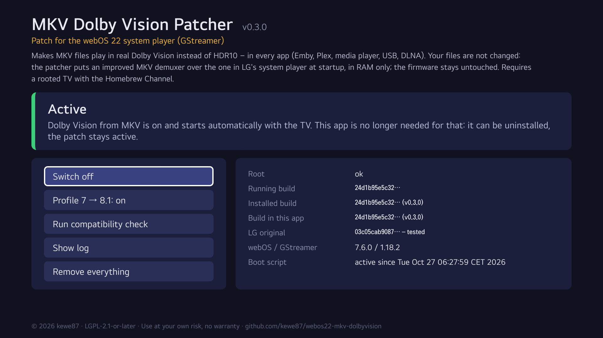
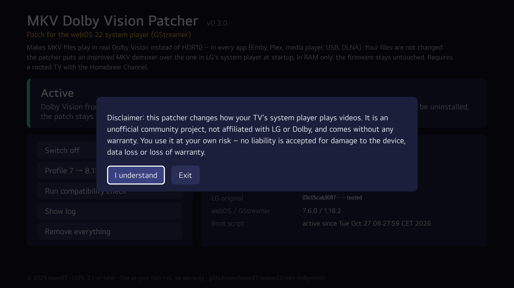
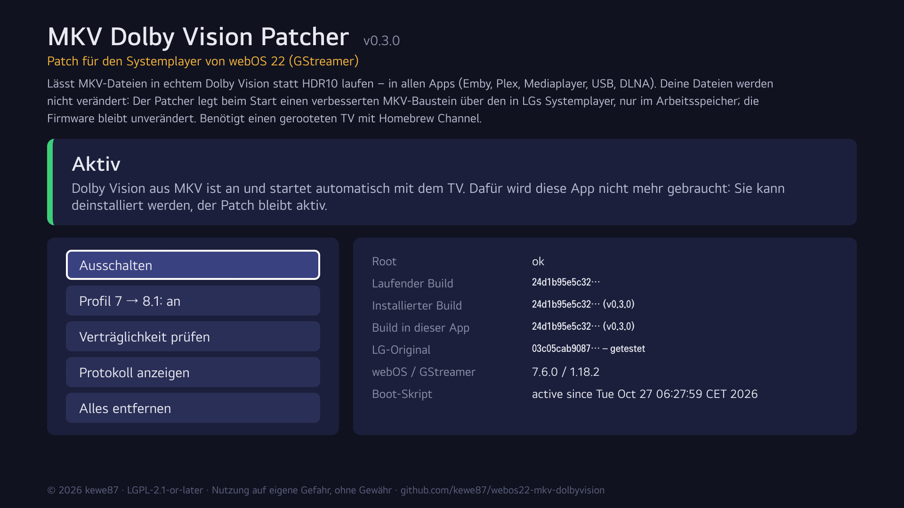

# webos22-mkv-dolbyvision

System-wide **Dolby Vision playback from MKV files** on LG TVs running **webOS 22**:
Emby, Plex, the LG media player, USB, DLNA – every app that uses LG's media pipeline.
Optionally converts **Dolby Vision profile 7** (UHD Blu-ray remuxes) to **profile 8.1** on the fly.

**What gets patched:** not your MKV files – they stay untouched. The patch replaces the MKV demuxer of
the TV's system player (GStreamer plugin `libgstmatroska.so`) with an improved version, in RAM only.
It comes with **MKV Dolby Vision Patcher**, a Homebrew Channel app to switch it on and off.



> **Requirements: a rooted TV.** Root access (e.g. via [RootMyTV](https://rootmy.tv) / the
> [webOS Homebrew Channel](https://github.com/webosbrew/webos-homebrew-channel)) and SSH are mandatory:
> the patched demuxer is put over a system file with a bind mount and started by a Homebrew Channel
> boot script. It does **not** work on non-rooted TVs.

> **Status: beta.** Tested on one TV only: LG 86QNED916QE (board K8HP), webOS 22, firmware 04.60.91.
> Profile 8.1 works (Dolby Vision logo in Emby). Profile 7 → 8.1 has been verified with dovi_tool test
> data and a synthetic clip, but **not yet with a real UHD Blu-ray remux**.

> **Disclaimer: use at your own risk.** This is an unofficial community project, not affiliated with
> or endorsed by LG or Dolby. It changes how your TV's system player works and requires root access.
> It is provided "as is", without warranty of any kind. The author accepts no liability for damage to
> your TV, data loss, loss of warranty or any other consequence of using it. See also sections 15 and 16
> of the `LICENSE`.

## Why

LG's webOS 22 plays Dolby Vision from MP4 and TS, but its matroska demuxer (`libgstmatroska.so`,
GStreamer 1.18.2) ignores the Dolby Vision configuration stored in MKV files
(`BlockAdditionMapping` with `dvcC`/`dvvC`). Every app therefore falls back to HDR10.
LG fixed this only in webOS 25.

## How it works

- `src/matroska/` is **LG's own webOS 22 source** of the GStreamer matroska plugin (from LG's
  open-source package "webOS 22 KHP 12.0", opensource.lge.com), patched with:
  - **Dolby Vision detection** ported from LG's webOS 25 code
    ([lgstreamer/gstreamer-webos-25](https://github.com/lgstreamer/gstreamer-webos-25)). It sets the
    same caps fields LG's webOS 22 MP4 demuxer uses (`dolby-vision`, `dolby-vision-profile`) and queries
    the platform's `dolby-vision-support` smart property like LG's qtdemux.
  - **Hardening compared to LG's webOS 25 code:**
    - it never posts an error – anything unexpected leaves the caps untouched (plain HDR10 as before);
    - only video tracks are flagged;
    - mapping values are only committed when the entry really is Dolby Vision, so HDR10+ block
      additions cannot overwrite them;
    - length check and missing `g_free` fixed.
  - **Profile 7 → 8.1** for HEVC tracks with BL compatibility 6, implemented as a per-frame
    postprocess step:
    - the enhancement layer is dropped (NAL type 63 and `nuh_layer_id > 0`);
    - every RPU (NAL type 62) is rewritten with [libdovi](https://github.com/quietvoid/dovi_tool),
      identical to `dovi_tool -m 2`;
    - an RPU that cannot be converted is dropped, never forwarded as profile 7.

    As with every player that does this (Zidoo, Shield/Plex, PlxNative), the residual of a **FEL**
    is lost; a **MEL** loses nothing.
- **Diagnostics:** a short log is written to `/tmp/matroska-dv.log` (configuration, decision, caps,
  conversion counters).
- `patches/` contains the full diff against LG's unmodified source.
- Built with LG's own toolchain (starfish SDK 7.0.0, GCC 9.3, Cortex-A9, softfp) against LG's sysroot.
  A rebuild of the unmodified LG source has the same dependencies and symbols as the file on the TV.

## Safety

- **RAM only:** LG's files are never modified. The bind mount lives in RAM; reboot without the boot
  script and the original is back. Nothing is written to firmware partitions.
- **Version check:** the boot script only activates when the original LG file matches a known checksum
  (`tv/supported-originals.md5`) and the replacement matches its own checksum. An untested original
  can be accepted on a single TV after the isolated check has passed (`ctl.sh enable --force`, or
  "Switch on" in the app); it is recorded in `/media/developer/mkvdv/supported-originals.local`.
- **Fallback behaviour:** unknown or unusual files keep LG's behaviour.
- **Off switches:**
  - the app's "Switch off" button, or `ctl.sh disable` – everything off (right away if no video is
    playing, otherwise after a reboot);
  - `touch /media/developer/mkvdv/disable` and reboot – everything off;
  - `touch /media/developer/mkvdv/disable-p7` – only the profile 7 conversion off (from the next
    playback on).

## Install with the app (recommended)

The release contains the Homebrew Channel app **MKV Dolby Vision Patcher**
(`io.github.kewe87.mkvdv_<version>_all.ipk`). It shows the status and has buttons to switch on/off,
toggle profile 7 → 8.1, run the compatibility check, show the logs and remove everything. English or
German, following the TV's language.

1. Install the `.ipk`, e.g. with `ares-install` or by adding the release's
   `io.github.kewe87.mkvdv.manifest.json` URL as a repository in the Homebrew Channel.
2. Open **MKV Dolby Vision Patcher**, accept the disclaimer and press **Switch on**.

| | |
|---|---|
|  |  |

**Root check:** the app runs `ctl.sh` as root through the Homebrew Channel's `exec` service. On every
start it first checks that this really works (`id -u` = 0). Without root it shows "Root service not
reachable" and every button except "Check again" is locked; `ctl.sh` itself refuses to run without root
as well. Make sure the Homebrew Channel shows "Root status: ok".

**Can I uninstall the app afterwards?** Yes. Switching on copies the demuxer and the boot script to
`/media/developer/mkvdv/`; the boot script does not depend on the app. The patch stays active, also
after reboots, when the app is removed. To remove the patch completely, press **Remove everything**
(or **Switch off**) *before* uninstalling the app – or later over SSH with
`sh /media/developer/mkvdv/ctl.sh uninstall`.

## Command line

The same functions over SSH (`/media/developer/mkvdv/ctl.sh` after the first install):

```sh
ctl.sh status            # JSON status
ctl.sh enable [--force]  # install/update and activate
ctl.sh disable           # deactivate
ctl.sh p7 on|off         # profile 7 -> 8.1 conversion
ctl.sh check             # load the build in an isolated GStreamer instance
ctl.sh log               # boot script and demuxer logs
ctl.sh uninstall         # deactivate and delete all files
```

## Manual install over SSH

1. Download `libgstmatroska.so` and `tv-scripts.tar.gz` from the
   [releases](../../releases) and copy them to the TV, e.g. into `/tmp/mkvdv-install/`.
   Use `scp -O` – piping binaries through some shells corrupts them.
2. Check your LG original:

   ```sh
   md5sum /usr/lib/gstreamer-1.0/libgstmatroska.so
   ```

   If the checksum is not listed in `supported-originals.md5`, run the isolated test below first.
   Only if it works, install with `--force`.
3. Install:

   ```sh
   cd /tmp/mkvdv-install && tar xzf tv-scripts.tar.gz && sh tv/install.sh
   ```

**Uninstall:** `sh /media/developer/mkvdv/ctl.sh uninstall` (a reboot is only needed if a video was
playing).

## Isolated test (no system change)

Runs a private GStreamer instance with its own registry in `/tmp`:

```sh
mkdir -p /tmp/mkvtest/dv && cp libgstmatroska.so /tmp/mkvtest/dv/
ln -sf /usr/lib/gstreamer-1.0/libgstcoreelements.so /tmp/mkvtest/dv/
env -i PATH=/usr/bin:/bin HOME=/tmp/mkvtest GST_REGISTRY_1_0=/tmp/mkvtest/reg.bin \
  GST_PLUGIN_SYSTEM_PATH_1_0=/tmp/mkvtest/dv GST_PLUGIN_PATH_1_0= \
  gst-launch-1.0 -v filesrc location=/path/to/dolby-vision.mkv ! matroskademux name=d d.video_0 ! fakesink
cat /tmp/matroska-dv.log
```

The video caps must contain `dolby-vision=(boolean)true, dolby-vision-profile=(int)8`
(for profile 5 files: `5`).

## Build (Linux / WSL)

1. Install LG's starfish SDK, `starfish-sdk-x86_64-ca9v1-toolchain-7.0.0.sh`, from part 1 of LG's
   "webOS 22 KHP" source package, e.g. into `~/tc/starfish`.
2. Extract `target_sysroot_dependencies.tar.gz` (inside `gstreamer_*.zip` of the same package) into
   `$SDKTARGETSYSROOT`.
3. Install Rust via rustup and add the TV target: `rustup target add armv7-unknown-linux-gnueabi`.
4. Build:

   ```sh
   build/build-libdovi.sh      # libdovi as a static library (pinned commit)
   build/build.sh              # -> out/libgstmatroska.so
   build/package.py            # -> out/release/ (.so, tv-scripts, .ipk, manifest, SHA256SUMS)
   ```

`tests/dovi_test.c` checks the libdovi conversion on the TV against dovi_tool's test data.
`tests/fakep7.py` turns a profile 8 clip into a synthetic profile 7 clip for pipeline tests.

## Limitations

- **webOS 22 only** (GStreamer 1.18.2). Other webOS versions need a build from LG's matching source
  package.
- **Profile 7 dual-track MKVs** (BL and EL as separate tracks) are not converted; the base layer plays
  as HDR10.
- **Hardware limits:** what the TV's video chip cannot do (e.g. FEL decoding, VVC) cannot be added.

## Credits and licenses

- **This project:** Copyright (c) 2026 kewe87, LGPL-2.1-or-later (required, because the demuxer is
  derived from GStreamer's LGPL code), see `LICENSE`.
- **Matroska plugin:** GStreamer (LGPL-2.1-or-later) with LG Electronics' modifications.
- **libdovi:** quietvoid, MIT, see `THIRD-PARTY-NOTICES.md`.
- **Idea for the profile 7 conversion on LG TVs:** PlxNative.
- Dolby, Dolby Vision and the double-D symbol are trademarks of Dolby Laboratories. This project is not
  affiliated with or endorsed by Dolby or LG.

**AI disclosure:** the code was developed with substantial help from an AI assistant (Claude by
Anthropic). It was built, tested and reviewed on a real TV by the maintainer, who is responsible for it.

---

## Kurzfassung (Deutsch)

Systemweites **Dolby Vision aus MKV** für LG-TVs mit **webOS 22**. Profil 7 (UHD-Blu-ray-Remuxe) wird
auf Wunsch live nach 8.1 umgewandelt.

**Gepatcht wird nicht die MKV-Datei**, sondern der MKV-Baustein im Systemplayer des TVs
(GStreamer-Plugin `libgstmatroska.so`). Deine Dateien bleiben unverändert.

**Voraussetzung ist ein gerooteter TV** (Homebrew Channel mit „Root status: ok“).

> **Haftungsausschluss:** Nutzung auf eigene Gefahr. Inoffizielles Community-Projekt, nicht von LG oder
> Dolby. Bereitgestellt ohne jede Gewähr; für Schäden am TV, Datenverlust, Verlust der Garantie oder
> andere Folgen wird keine Haftung übernommen.

- **Funktionsweise:** LGs eigener webOS-22-Quellcode des MKV-Bausteins, ergänzt um LGs
  Dolby-Vision-Erkennung aus webOS 25. Der Baustein wird per Bind-Mount nur im Arbeitsspeicher über das
  Original gelegt.
- **Bedienung:** Die Homebrew-Channel-App „MKV Dolby Vision Patcher“ (`.ipk` im Release) zeigt den
  Status und schaltet ein und aus, auf Deutsch, wenn der TV auf Deutsch steht. Sie prüft beim Start, ob
  sie Root-Rechte bekommt; ohne Root ist alles gesperrt. Per SSH geht dasselbe mit `ctl.sh`.
- **App danach deinstallieren:** geht. Der Patch liegt dann in `/media/developer/mkvdv/` und bleibt
  aktiv, auch nach Neustarts. Wer ihn ganz loswerden will, drückt vorher „Alles entfernen“.
- **Rückgängig machen:** In der App „Ausschalten“, oder ein Neustart ohne das Boot-Skript stellt den
  Originalzustand her.
- **Status:** Beta, getestet auf einem LG 86QNED916QE (Firmware 04.60.91).
- **Hinweis:** Entwickelt mit KI-Unterstützung, getestet auf einem echten TV.
